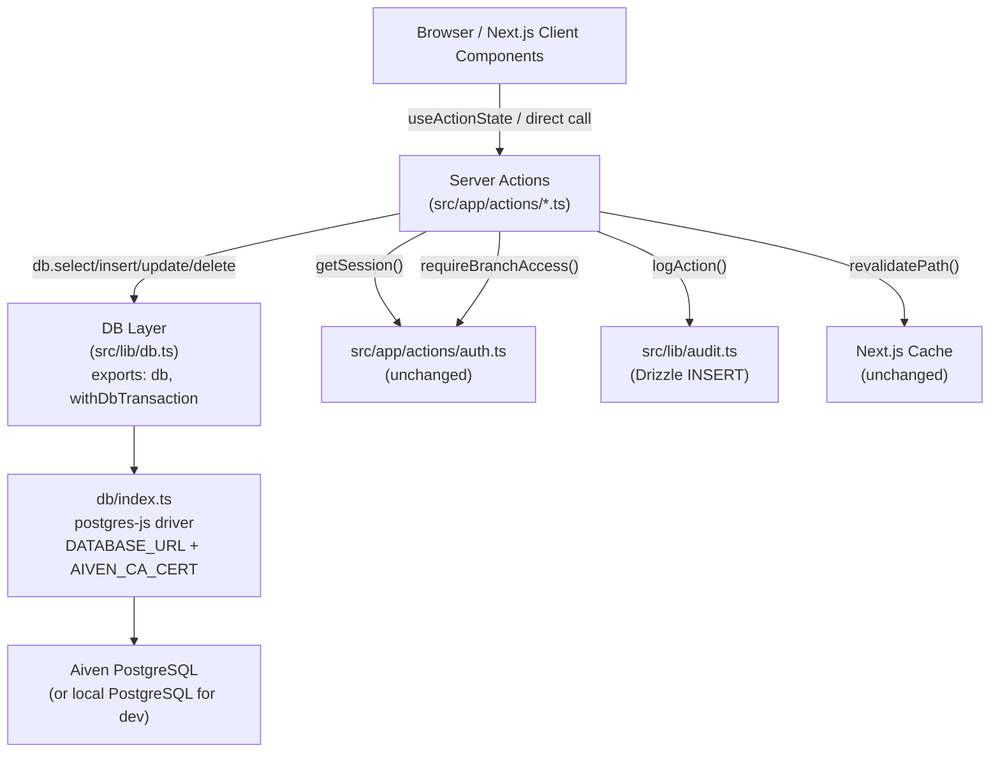

# Design Document: JSON Store to RDBMS Migration

## Overview

This migration replaces the application's current JSON blob store — a single PostgreSQL table `json_store(filename PK, data text)` where every collection is a serialized JSON array — with 27 normalized Drizzle ORM tables. All Server Actions are rewritten to use typed Drizzle queries. The external contract of every action (signature, return shape, branch-scoping, audit, revalidate) stays identical; no client component or hook changes.

---

## Architecture

### System Component Diagram



### Migration Phases

| Phase | What changes | Key deliverable |
|---|---|---|
| 1 — Schema | `db/schema.ts` expands from 2 to 29 tables | New Drizzle table definitions + `drizzle-kit generate` migration SQL |
| 2 — Code conversion | All action files + `src/lib/db.ts` + `src/lib/audit.ts` | Drizzle queries replace `readJSON`/`withTransaction` |
| 3 — Driver simplification | `db/index.ts` reduced to single postgres-js driver; remove `@netlify/database` and `@neondatabase/serverless` packages | `DATABASE_URL` only; zero conditional driver branching |
| 4 — Data migration | `scripts/migrate-from-json-store.ts` | One-shot backup + upsert script |

### What Does Not Change

- `src/proxy.ts` (middleware gate)
- All client components, hooks, `page.tsx` files
- `src/app/actions/auth.ts` (`getSession`, `requireBranchAccess`, JWT/bcrypt logic)

  > **Note**: While `getSession`, `requireBranchAccess`, JWT signing, and cookie logic in `auth.ts` are unchanged, the `login` function and `migratePasswordsToHash` function within `auth.ts` DO require updates — they currently read from `DB_FILES.USERS` via `readJSON` and must be migrated to Drizzle `SELECT`/`UPDATE` queries against the `users` table.

- Navigation and session gate behavior (the **output** of `src/proxy.ts` and `src/app/management/layout.tsx` is unchanged; only their internal DB reads are migrated)
- Action return shapes: `{ error }` | `{ success: true }` | `{ success: true, warning }` | `{ success: true, message }`
- `revalidatePath` call sites and paths
- `logAction` call signature
- `src/lib/rate-limit.ts` — already uses `db` directly from `db/index.ts`, unchanged
- Branch-scoping enforcement pattern
- No `NETLIFY` env flag handling anywhere in app code after cutover

---

## Database Schema Design

All tables follow these conventions:

- **Surrogate PK**: `bigserial` column `pk` (internal DB use only, never exposed to application code)
- **App ID**: `varchar` column `id` with `unique` constraint — matches the existing `st_xxx`, `br_xxx`, etc. prefixed IDs used throughout the codebase
- **snake_case** column names in DB; TypeScript types remain camelCase
- **No SQL foreign keys** — relationships enforced in application code
- **Monetary columns**: `integer` (never `numeric`)
- **Date-only columns** (IST YYYY-MM-DD strings): `varchar(10)`
- **Timestamp columns**: `timestamptz`
- **Complex embedded objects never queried by sub-field**: `jsonb`

### branches

```ts
export const branches = pgTable('branches', {
  pk:                  bigserial('pk', { mode: 'number' }).primaryKey(),
  id:                  varchar('id', { length: 255 }).notNull().unique(),
  name:                varchar('name', { length: 100 }).notNull(),
  address:             varchar('address', { length: 200 }),
  phone:               varchar('phone', { length: 50 }),
  status:              varchar('status', { length: 20 }).notNull().default('operational'),
  internalStartTime:   varchar('internal_start_time', { length: 5 }),
  internalEndTime:     varchar('internal_end_time', { length: 5 }),
  customerStartTime:   varchar('customer_start_time', { length: 5 }),
  customerEndTime:     varchar('customer_end_time', { length: 5 }),
  isActive:            boolean('is_active').notNull().default(true),
  deletedAt:           timestamptz('deleted_at'),
})

// Indexes
export const branchesNameIdx = index('branches_name_idx').on(branches.name)
```

### departments

```ts
export const departments = pgTable('departments', {
  pk:        bigserial('pk', { mode: 'number' }).primaryKey(),
  id:        varchar('id', { length: 255 }).notNull().unique(),
  name:      varchar('name', { length: 100 }).notNull(),
  isActive:  boolean('is_active').notNull().default(true),
  deletedAt: timestamptz('deleted_at'),
})
```

### roles

```ts
export const roles = pgTable('roles', {
  pk:            bigserial('pk', { mode: 'number' }).primaryKey(),
  id:            varchar('id', { length: 255 }).notNull().unique(),
  name:          varchar('name', { length: 100 }).notNull(),
  isChef:        boolean('is_chef').default(false),
  departmentIds: jsonb('department_ids'),  // string[] — queried only as a set membership check in code
  isActive:      boolean('is_active').notNull().default(true),
  deletedAt:     timestamptz('deleted_at'),
})
```

> `departmentIds` is `jsonb` because it is a variable-length array of department ID strings. The code only ever checks membership (`includes(id)`) and does full-array updates — there is no query predicate that filters by individual departmentId values against the DB.

### staff

```ts
export const staff = pgTable('staff', {
  pk:             bigserial('pk', { mode: 'number' }).primaryKey(),
  id:             varchar('id', { length: 255 }).notNull().unique(),
  name:           varchar('name', { length: 100 }).notNull(),
  branchId:       varchar('branch_id', { length: 255 }).notNull(),
  departmentId:   varchar('department_id', { length: 255 }).notNull(),
  roleId:         varchar('role_id', { length: 255 }).notNull(),
  phone:          varchar('phone', { length: 15 }).notNull(),
  label:          varchar('label', { length: 50 }),
  monthlySalary:  integer('monthly_salary').default(0),
  isActive:       boolean('is_active').notNull().default(true),
  joinedAt:       varchar('joined_at', { length: 10 }),  // YYYY-MM-DD string
  exitDate:       varchar('exit_date', { length: 10 }),
  shiftType:      varchar('shift_type', { length: 10 }),
  specialtyId:    varchar('specialty_id', { length: 255 }),
  positionId:     varchar('position_id', { length: 255 }),
  positionIndex:  integer('position_index'),
  startTime:      varchar('start_time', { length: 5 }),
  endTime:        varchar('end_time', { length: 5 }),
  deletedAt:      timestamptz('deleted_at'),
})

export const staffBranchIdx  = index('staff_branch_idx').on(staff.branchId)
export const staffRoleIdx    = index('staff_role_idx').on(staff.roleId)
export const staffPositionIdx = index('staff_position_idx').on(staff.positionId)
// Partial index — most lookups filter active staff
export const staffActiveBranchIdx = index('staff_active_branch_idx')
  .on(staff.branchId, staff.isActive)
  .where(sql`is_active = true`)
```

### staff_requirements

```ts
export const staffRequirements = pgTable('staff_requirements', {
  pk:             bigserial('pk', { mode: 'number' }).primaryKey(),
  id:             varchar('id', { length: 255 }).notNull().unique(),
  branchId:       varchar('branch_id', { length: 255 }).notNull(),
  departmentId:   varchar('department_id', { length: 255 }).notNull(),  // required — part of duplicate check
  roleId:         varchar('role_id', { length: 255 }).notNull(),
  positionId:     varchar('position_id', { length: 255 }),
  name:           varchar('name', { length: 100 }),
  requiredCount:  integer('required_count').notNull().default(1),  // renamed from 'count' to match TypeScript type
  shiftType:      varchar('shift_type', { length: 10 }),
  specialtyId:    varchar('specialty_id', { length: 255 }),
  defaultSalary:  integer('default_salary'),                        // integer rupees; nullable
  startTime:      varchar('start_time', { length: 5 }),             // HH:MM
  endTime:        varchar('end_time', { length: 5 }),               // HH:MM
  responsibility: varchar('responsibility', { length: 500 }),
  schedules:      jsonb('schedules'),                               // PositionSchedule[] — complex nested structure
  isActive:       boolean('is_active').notNull().default(true),
  // Hard delete collection — no deletedAt column
})

export const staffReqBranchIdx = index('staff_req_branch_idx').on(staffRequirements.branchId)
export const staffReqRoleIdx   = index('staff_req_role_idx').on(staffRequirements.roleId)
// Duplicate detection: a position (branch + department + role) can only be defined once
export const staffReqUniq = uniqueIndex('staff_req_branch_dept_role_uniq')
  .on(staffRequirements.branchId, staffRequirements.departmentId, staffRequirements.roleId)
  .where(sql`is_active = true`)
```

> `staff_requirements` is a hard-delete collection (confirmed by the existing implementation). No `deletedAt` column.
> `schedules` is `jsonb` — the `PositionSchedule[]` array is a complex nested structure only accessed as a whole; no SQL predicate filters by individual schedule fields.

### attendance

```ts
export const attendance = pgTable('attendance', {
  pk:           bigserial('pk', { mode: 'number' }).primaryKey(),
  id:           varchar('id', { length: 255 }).notNull().unique(),
  date:         varchar('date', { length: 10 }).notNull(),  // YYYY-MM-DD IST
  staffId:      varchar('staff_id', { length: 255 }).notNull(),
  branchId:     varchar('branch_id', { length: 255 }).notNull(),
  status:       varchar('status', { length: 20 }).notNull().default('present'),
  shiftsWorked: jsonb('shifts_worked'),   // string[] — array of shift labels
  createdAt:    timestamptz('created_at').notNull(),  // when record was first created (upsert-safe)
  updatedAt:    timestamptz('updated_at').notNull(),
})

export const attendanceDateIdx    = index('attendance_date_idx').on(attendance.date)
export const attendanceBranchIdx  = index('attendance_branch_idx').on(attendance.branchId)
export const attendanceStaffIdx   = index('attendance_staff_idx').on(attendance.staffId)
// Unique constraint enables upsert ON CONFLICT
export const attendanceDateStaffUniq = uniqueIndex('attendance_date_staff_uniq')
  .on(attendance.date, attendance.staffId)
```

> `shiftsWorked` is `jsonb` — it is an array of shift-label strings appended or read as a whole, never queried by individual element in SQL.
> `createdAt` is set once on first insert and never updated; `updatedAt` is refreshed on every upsert. Use the ON CONFLICT clause to update only `updatedAt` (not `createdAt`).

### payroll

```ts
export const payroll = pgTable('payroll', {
  pk:             bigserial('pk', { mode: 'number' }).primaryKey(),
  id:             varchar('id', { length: 255 }).notNull().unique(),  // pay_{month}_{year}_{staffId}
  staffId:        varchar('staff_id', { length: 255 }).notNull(),
  branchId:       varchar('branch_id', { length: 255 }),
  name:           varchar('name', { length: 100 }).notNull(),
  month:          integer('month').notNull(),
  year:           integer('year').notNull(),
  monthlySalary:  integer('monthly_salary').notNull().default(0),
  daysWorked:     integer('days_worked').notNull().default(0),
  advances:       integer('advances').notNull().default(0),
  payableAmount:  integer('payable_amount').notNull().default(0),
  status:         varchar('status', { length: 10 }).notNull().default('PENDING'),
  notes:          varchar('notes', { length: 500 }),
  paidAt:         timestamptz('paid_at'),
})

export const payrollMonthYearIdx      = index('payroll_month_year_idx').on(payroll.month, payroll.year)
export const payrollMonthYearStaffIdx = index('payroll_month_year_staff_idx')
  .on(payroll.month, payroll.year, payroll.staffId)
export const payrollBranchIdx         = index('payroll_branch_idx').on(payroll.branchId)
```

### eod

```ts
export const eod = pgTable('eod', {
  pk:                   bigserial('pk', { mode: 'number' }).primaryKey(),
  id:                   varchar('id', { length: 255 }).notNull().unique(),
  branchId:             varchar('branch_id', { length: 255 }).notNull(),
  date:                 varchar('date', { length: 10 }).notNull(),  // YYYY-MM-DD IST
  income:               jsonb('income').notNull(),    // EODIncome: { dineInCash, dineInUpi, takeawayCash, takeawayUpi }
  openingFloat:         integer('opening_float'),
  actualClosingFloat:   integer('actual_closing_float'),
  notes:                varchar('notes', { length: 2000 }),
  status:               varchar('status', { length: 20 }).notNull().default('submitted'),
  billing:              jsonb('billing'),  // EODEntry.billing object — never queried by sub-field
  ops:                  jsonb('ops'),      // EODEntry.ops object — never queried by sub-field
  createdAt:            timestamptz('created_at').notNull(),
  updatedAt:            timestamptz('updated_at').notNull(),
})

export const eodDateIdx    = index('eod_date_idx').on(eod.date)
export const eodBranchIdx  = index('eod_branch_idx').on(eod.branchId)
export const eodBranchDateUniq = uniqueIndex('eod_branch_date_uniq').on(eod.branchId, eod.date)
```

> `income`, `billing`, and `ops` are `jsonb` — they are always read/written as complete objects. The application computes totals in memory. No SQL query ever filters on `income.dineInCash` etc.

### expenses

```ts
export const expenses = pgTable('expenses', {
  pk:         bigserial('pk', { mode: 'number' }).primaryKey(),
  id:         varchar('id', { length: 255 }).notNull().unique(),
  branchId:   varchar('branch_id', { length: 255 }).notNull(),
  amount:     integer('amount').notNull(),
  categoryId: varchar('category_id', { length: 255 }).notNull(),
  source:     varchar('source', { length: 20 }).notNull(),   // 'eod' | 'vendor'
  date:       varchar('date', { length: 10 }).notNull(),     // YYYY-MM-DD IST
  notes:      varchar('notes', { length: 500 }),
  isPaid:     boolean('is_paid').default(false),
  createdAt:  timestamptz('created_at').notNull(),
})

export const expensesDateIdx   = index('expenses_date_idx').on(expenses.date)
export const expensesBranchIdx = index('expenses_branch_idx').on(expenses.branchId)
export const expensesSourceIdx = index('expenses_source_branch_date_idx')
  .on(expenses.source, expenses.branchId, expenses.date)
```

### categories

```ts
export const categories = pgTable('categories', {
  pk:        bigserial('pk', { mode: 'number' }).primaryKey(),
  id:        varchar('id', { length: 255 }).notNull().unique(),
  name:      varchar('name', { length: 100 }).notNull(),
  color:     varchar('color', { length: 20 }),
  isActive:  boolean('is_active').notNull().default(true),
  deletedAt: timestamptz('deleted_at'),
})
```

### menu_items

```ts
export const menuItems = pgTable('menu_items', {
  pk:           bigserial('pk', { mode: 'number' }).primaryKey(),
  id:           varchar('id', { length: 255 }).notNull().unique(),
  name:         varchar('name', { length: 150 }).notNull(),
  categoryId:   varchar('category_id', { length: 255 }).notNull(),
  basePrice:    integer('base_price').notNull().default(0),
  sortOrder:    integer('sort_order').notNull().default(0),
  isActive:     boolean('is_active').notNull().default(true),
  description:  varchar('description', { length: 1000 }),
  imageUrl:     varchar('image_url', { length: 500 }),
  costPrice:    integer('cost_price'),
  dietary:      jsonb('dietary'),       // string[] — filter array, no SQL predicate needed
  spiceLevel:   integer('spice_level'),
  allergens:    jsonb('allergens'),     // string[] — same rationale as dietary
  isSignature:  boolean('is_signature'),
  prepTimeMins: integer('prep_time_mins'),
  availability: jsonb('availability'),  // AvailabilityWindow { days?, startTime?, endTime? }
  createdAt:    timestamptz('created_at').notNull(),
  updatedAt:    timestamptz('updated_at').notNull(),
  deletedAt:    timestamptz('deleted_at'),
})

export const menuItemsCategoryIdx  = index('menu_items_category_idx').on(menuItems.categoryId)
export const menuItemsActiveIdx    = index('menu_items_active_idx')
  .on(menuItems.isActive)
  .where(sql`is_active = true`)
```

> `dietary`, `allergens`, and `availability` are `jsonb` — they are arrays/objects written and read as whole values; no query filters by individual dietary tag in the DB.

### menu_categories

```ts
export const menuCategories = pgTable('menu_categories', {
  pk:        bigserial('pk', { mode: 'number' }).primaryKey(),
  id:        varchar('id', { length: 255 }).notNull().unique(),
  name:      varchar('name', { length: 100 }).notNull(),
  sortOrder: integer('sort_order').notNull().default(0),
  isActive:  boolean('is_active').notNull().default(true),
  deletedAt: timestamptz('deleted_at'),
})
```

### branch_menu_items

```ts
export const branchMenuItems = pgTable('branch_menu_items', {
  pk:          bigserial('pk', { mode: 'number' }).primaryKey(),
  id:          varchar('id', { length: 255 }).notNull().unique(),
  branchId:    varchar('branch_id', { length: 255 }).notNull(),
  menuItemId:  varchar('menu_item_id', { length: 255 }).notNull(),
  variantId:   varchar('variant_id', { length: 255 }),
  price:       integer('price'),    // null = use base price
  isAvailable: boolean('is_available').notNull().default(true),
})

export const branchMenuItemsBranchIdx    = index('bmi_branch_idx').on(branchMenuItems.branchId)
export const branchMenuItemsItemIdx      = index('bmi_menu_item_idx').on(branchMenuItems.menuItemId)
export const branchMenuItemsUniq         = uniqueIndex('bmi_branch_item_variant_uniq')
  .on(branchMenuItems.branchId, branchMenuItems.menuItemId, branchMenuItems.variantId)
```

> This table replaces both the legacy `branch_menu_items.json` blob and all sharded `branch_menu_items_{branchId}.json` files. A `WHERE branch_id = $1` index query does the same job as the old shard pattern.

### branch_categories

```ts
export const branchCategories = pgTable('branch_categories', {
  pk:          bigserial('pk', { mode: 'number' }).primaryKey(),
  id:          varchar('id', { length: 255 }).notNull().unique(),
  branchId:    varchar('branch_id', { length: 255 }).notNull(),
  categoryId:  varchar('category_id', { length: 255 }).notNull(),
  isAvailable: boolean('is_available').notNull().default(true),  // matches BranchMenuCategory.isAvailable
})

export const branchCategoriesBranchIdx = index('branch_cat_branch_idx').on(branchCategories.branchId)
```

### menu_item_variants

```ts
export const menuItemVariants = pgTable('menu_item_variants', {
  pk:         bigserial('pk', { mode: 'number' }).primaryKey(),
  id:         varchar('id', { length: 255 }).notNull().unique(),
  menuItemId: varchar('menu_item_id', { length: 255 }).notNull(),
  name:       varchar('name', { length: 60 }).notNull(),
  basePrice:  integer('base_price').notNull().default(0),
  sortOrder:  integer('sort_order').notNull().default(0),
  isActive:   boolean('is_active').notNull().default(true),
  deletedAt:  timestamptz('deleted_at'),  // soft-delete: menu.ts sets isActive=false on variant delete
})

export const menuItemVariantsItemIdx = index('variants_menu_item_idx').on(menuItemVariants.menuItemId)
```

### menu_price_history

```ts
export const menuPriceHistory = pgTable('menu_price_history', {
  pk:            bigserial('pk', { mode: 'number' }).primaryKey(),
  id:            varchar('id', { length: 255 }).notNull().unique(),
  menuItemId:    varchar('menu_item_id', { length: 255 }).notNull(),
  variantId:     varchar('variant_id', { length: 255 }),
  branchId:      varchar('branch_id', { length: 255 }),
  scope:         varchar('scope', { length: 10 }).notNull(),  // 'base' | 'branch'
  oldPrice:      integer('old_price'),
  newPrice:      integer('new_price'),
  changedBy:     varchar('changed_by', { length: 255 }).notNull(),
  changedByName: varchar('changed_by_name', { length: 100 }).notNull(),
  changedAt:     timestamptz('changed_at').notNull(),
})

export const priceHistoryItemIdx = index('price_history_item_idx').on(menuPriceHistory.menuItemId)
```

### inventory

```ts
export const inventory = pgTable('inventory', {
  pk:              bigserial('pk', { mode: 'number' }).primaryKey(),
  id:              varchar('id', { length: 255 }).notNull().unique(),
  branchId:        varchar('branch_id', { length: 255 }).notNull(),
  name:            varchar('name', { length: 100 }).notNull(),
  unit:            varchar('unit', { length: 20 }).notNull(),
  currentQuantity: integer('current_quantity').notNull().default(0),
  threshold:       integer('threshold').notNull().default(0),
  updatedAt:       timestamptz('updated_at').notNull(),
  isActive:        boolean('is_active').notNull().default(true),
  deletedAt:       timestamptz('deleted_at'),
})

export const inventoryBranchIdx = index('inventory_branch_idx').on(inventory.branchId)
export const inventoryActiveIdx = index('inventory_active_branch_idx')
  .on(inventory.branchId, inventory.isActive)
  .where(sql`is_active = true`)
```

### stock_adjustments

```ts
export const stockAdjustments = pgTable('stock_adjustments', {
  pk:       bigserial('pk', { mode: 'number' }).primaryKey(),
  id:       varchar('id', { length: 255 }).notNull().unique(),
  itemId:   varchar('item_id', { length: 255 }).notNull(),
  branchId: varchar('branch_id', { length: 255 }).notNull(),
  type:     varchar('type', { length: 10 }).notNull(),   // 'increase' | 'decrease'
  amount:   integer('amount').notNull(),
  reason:   varchar('reason', { length: 200 }).notNull(),
  date:     varchar('date', { length: 10 }).notNull(),   // YYYY-MM-DD IST string — matches StockAdjustment.date: string
})

export const stockAdjBranchIdx = index('stock_adj_branch_idx').on(stockAdjustments.branchId)
export const stockAdjItemIdx   = index('stock_adj_item_idx').on(stockAdjustments.itemId)
export const stockAdjDateIdx   = index('stock_adj_date_idx').on(stockAdjustments.date)
```

> `date` is `varchar(10)` not `timestamptz` — the `StockAdjustment` TypeScript type uses `date: string` and the action passes a date string from `formData`. This is consistent with all other date-only columns in the schema (`expenses.date`, `attendance.date`, `eod.date`, etc.).

### vendors

```ts
export const vendors = pgTable('vendors', {
  pk:         bigserial('pk', { mode: 'number' }).primaryKey(),
  id:         varchar('id', { length: 255 }).notNull().unique(),
  branchId:   varchar('branch_id', { length: 255 }).notNull(),
  name:       varchar('name', { length: 100 }).notNull(),
  phone:      varchar('phone', { length: 15 }).notNull(),
  supplyType: varchar('supply_type', { length: 100 }).notNull(),
  isActive:   boolean('is_active').notNull().default(true),  // future soft-delete; also guards cascade on deleteBranch
  createdAt:  timestamptz('created_at').notNull(),
})

export const vendorsBranchIdx = index('vendors_branch_idx').on(vendors.branchId)
```

### pos_tables

```ts
export const posTables = pgTable('pos_tables', {
  pk:        bigserial('pk', { mode: 'number' }).primaryKey(),
  id:        varchar('id', { length: 255 }).notNull().unique(),
  branchId:  varchar('branch_id', { length: 255 }).notNull(),
  name:      varchar('name', { length: 50 }).notNull(),
  isActive:  boolean('is_active').notNull().default(true),
  createdAt: timestamptz('created_at').notNull(),
  updatedAt: timestamptz('updated_at').notNull(),
  deletedAt: timestamptz('deleted_at'),
})

export const posTablesBranchIdx    = index('pos_tables_branch_idx').on(posTables.branchId)
export const posTablesActiveIdx    = index('pos_tables_active_branch_idx')
  .on(posTables.branchId, posTables.isActive)
  .where(sql`is_active = true`)
export const posTablesBranchNameUniq = uniqueIndex('pos_tables_branch_name_uniq')
  .on(posTables.branchId, posTables.name)
  .where(sql`is_active = true`)
```

### pos_orders

```ts
export const posOrders = pgTable('pos_orders', {
  pk:               bigserial('pk', { mode: 'number' }).primaryKey(),
  id:               varchar('id', { length: 255 }).notNull().unique(),
  branchId:         varchar('branch_id', { length: 255 }).notNull(),
  tableId:          varchar('table_id', { length: 255 }),
  takeawayNumber:   varchar('takeaway_number', { length: 20 }),
  orderType:        varchar('order_type', { length: 10 }).notNull(),    // 'dine-in' | 'takeaway'
  covers:           integer('covers'),
  status:           varchar('status', { length: 10 }).notNull().default('open'),
  items:            jsonb('items').notNull().default(sql`'[]'::jsonb`),  // OrderItem[]
  note:             varchar('note', { length: 200 }),
  kotCount:         integer('kot_count').notNull().default(0),
  bill:             jsonb('bill'),       // BillSnapshot — set on transition to 'billed'
  payment:          jsonb('payment'),   // PaymentSnapshot — set on transition to 'paid'
  void:             jsonb('void'),      // VoidInfo — set on transition to 'voided'
  date:             varchar('date', { length: 10 }).notNull(),  // YYYY-MM-DD IST
  openedBy:         varchar('opened_by', { length: 255 }).notNull(),
  createdAt:        timestamptz('created_at').notNull(),
  updatedAt:        timestamptz('updated_at').notNull(),
})

export const posOrdersBranchIdx    = index('pos_orders_branch_idx').on(posOrders.branchId)
export const posOrdersDateIdx      = index('pos_orders_date_idx').on(posOrders.date)
export const posOrdersStatusIdx    = index('pos_orders_status_idx').on(posOrders.status)
export const posOrdersTableIdx     = index('pos_orders_table_idx').on(posOrders.tableId)
export const posOrdersBranchDateIdx = index('pos_orders_branch_date_idx')
  .on(posOrders.branchId, posOrders.date)
// Partial unique index: a dine-in table can only have ONE open order at a time (GAP 4)
export const posOrdersOpenTableUniq = uniqueIndex('pos_orders_open_table_uniq')
  .on(posOrders.tableId)
  .where(sql`status = 'open' AND table_id IS NOT NULL`)
// Composite partial index for efficient open-order-by-table lookups (GAP 14)
// Used by deactivateTable (hasOpenOrder check) and createOrder (table-occupied check)
export const posOrdersOpenByTableIdx = index('pos_orders_open_by_table_idx')
  .on(posOrders.tableId, posOrders.status)
  .where(sql`status = 'open' AND table_id IS NOT NULL`)
```

> `items` is `jsonb` — the embedded `OrderItem[]` array is only accessed in full; no query ever filters `pos_orders WHERE items->>'menuItemId' = $1`. Bill, payment, and void snapshots are similarly embedded: they are only ever set atomically with a status transition and read back as whole objects.

### pos_kots

```ts
export const posKots = pgTable('pos_kots', {
  pk:        bigserial('pk', { mode: 'number' }).primaryKey(),
  id:        varchar('id', { length: 255 }).notNull().unique(),
  orderId:   varchar('order_id', { length: 255 }).notNull(),
  branchId:  varchar('branch_id', { length: 255 }).notNull(),
  kotNumber: integer('kot_number').notNull(),
  items:     jsonb('items').notNull().default(sql`'[]'::jsonb`),  // KotItem[]
  status:    varchar('status', { length: 20 }).notNull().default('pending'),
  firedBy:   varchar('fired_by', { length: 255 }).notNull(),
  firedAt:   timestamptz('fired_at').notNull(),
  updatedAt: timestamptz('updated_at').notNull(),
})

export const posKotsOrderIdx  = index('pos_kots_order_idx').on(posKots.orderId)
export const posKotsBranchIdx = index('pos_kots_branch_idx').on(posKots.branchId)
export const posKotsStatusIdx = index('pos_kots_status_idx').on(posKots.status)
```

> `items` is `jsonb` — the `KotItem[]` array represents the delta snapshot at fire time. Querying individual items in SQL provides no benefit; the whole array is read per KOT fetch.

### config

```ts
export const config = pgTable('config', {
  pk:                    bigserial('pk', { mode: 'number' }).primaryKey(),
  id:                    varchar('id', { length: 50 }).notNull().unique().default('global'),
  attendance:            boolean('attendance').notNull().default(false),
  payroll:               boolean('payroll').notNull().default(false),
  vendors:               boolean('vendors').notNull().default(false),
  inventory:             boolean('inventory').notNull().default(false),
  menu:                  boolean('menu').notNull().default(true),
  reports:               boolean('reports').notNull().default(false),
  pos:                   boolean('pos').notNull().default(true),
  posDefaultGstPercent:  integer('pos_default_gst_percent').notNull().default(5),
})
```

> Single-row table. Always upserted on `id = 'global'`. All columns are scalar — no `jsonb` needed.

### users

```ts
export const users = pgTable('users', {
  pk:        bigserial('pk', { mode: 'number' }).primaryKey(),
  id:        varchar('id', { length: 255 }).notNull().unique(),
  name:      varchar('name', { length: 100 }).notNull(),
  password:  varchar('password', { length: 255 }),  // nullable — matches User.password?: string (bcrypt hash)
  role:      varchar('role', { length: 20 }).notNull(),
  branchId:  varchar('branch_id', { length: 255 }),
  isActive:  boolean('is_active').notNull().default(true),
  deletedAt: timestamptz('deleted_at'),
})
```

> `isAdmin`, `isGlobalOwner`, and `posRole` are NOT stored columns — they are JWT payload flags computed at login time from the `role` field (see `auth.ts`). Storing them would create a denormalized source of truth. The `password` column is nullable to match the `User` type's `password?: string` — a user record may exist before a password is set.

### audit_logs

```ts
export const auditLogs = pgTable('audit_logs', {
  pk:         bigserial('pk', { mode: 'number' }).primaryKey(),
  id:         varchar('id', { length: 255 }).notNull().unique(),
  timestamp:  timestamptz('timestamp').notNull(),
  userId:     varchar('user_id', { length: 255 }).notNull(),
  userName:   varchar('user_name', { length: 100 }).notNull(),
  action:     varchar('action', { length: 100 }).notNull(),
  entityType: varchar('entity_type', { length: 100 }).notNull(),
  entityId:   varchar('entity_id', { length: 255 }),
  details:    text('details').notNull(),
})

export const auditLogsTimestampIdx = index('audit_logs_timestamp_idx').on(auditLogs.timestamp)
```

### advances

```ts
export const advances = pgTable('advances', {
  pk:       bigserial('pk', { mode: 'number' }).primaryKey(),
  id:       varchar('id', { length: 255 }).notNull().unique(),
  staffId:  varchar('staff_id', { length: 255 }).notNull(),
  branchId: varchar('branch_id', { length: 255 }).notNull(),
  amount:   integer('amount').notNull(),
  date:     varchar('date', { length: 10 }).notNull(),
  notes:    varchar('notes', { length: 500 }),
  createdAt: timestamptz('created_at').notNull(),
})
```

> Currently unused but seeded as `[]`. Table is defined for schema completeness and future use.

### daily_tally

```ts
export const dailyTally = pgTable('daily_tally', {
  pk:       bigserial('pk', { mode: 'number' }).primaryKey(),
  id:       varchar('id', { length: 255 }).notNull().unique(),
  branchId: varchar('branch_id', { length: 255 }).notNull(),
  date:     varchar('date', { length: 10 }).notNull(),
  data:     jsonb('data'),
  createdAt: timestamptz('created_at').notNull(),
})
```

> Currently unused but seeded as `[]`. `data` is `jsonb` as the tally structure is undefined.

---

## DB Layer (`src/lib/db.ts`) Redesign

### New exports

After migration, `src/lib/db.ts` exports only two things:

```ts
export { db } from '../../db/index'
export { withDbTransaction } from './dbTransaction'
```

All old exports — `readJSON`, `writeJSON`, `withTransaction`, `DB_FILES`, `branchMenuItemsFile`, `readBranchMenuItems`, `withBranchMenuTransaction`, and the `Mutex` class — are removed after all action files are migrated.

### `withDbTransaction` implementation

```ts
// src/lib/db.ts
import { db } from '../../db/index'

export { db }

/**
 * Wraps a callback in a Drizzle database transaction.
 * Re-throws on failure so the caller can catch and return { error: 'Transaction failed' }.
 * 
 * For most operations, the default READ COMMITTED isolation is sufficient.
 * For counter patterns (e.g. takeaway number assignment) where two concurrent transactions
 * must not read the same count, use isolationLevel: 'serializable'.
 * 
 * Usage:
 *   try {
 *     const result = await withDbTransaction(async (tx) => {
 *       await tx.insert(table).values({...})
 *       return { success: true }
 *     })
 *   } catch {
 *     return { error: 'Transaction failed' }
 *   }
 */
export async function withDbTransaction<T>(
  callback: (tx: typeof db) => Promise<T>,
  options?: { isolationLevel?: 'read committed' | 'repeatable read' | 'serializable' }
): Promise<T> {
  return db.transaction(async (tx) => {
    return callback(tx as typeof db)
  }, options)
}
```

### Error contract

`withDbTransaction` re-throws any error from the callback. The calling action wraps it in `try/catch` and returns `{ error: 'Transaction failed' }`. Drizzle automatically rolls back the transaction when an error is thrown inside `db.transaction()`.

### Transaction Isolation Level Strategy

PostgreSQL defaults to `READ COMMITTED` isolation. For most single-row mutations in this codebase, that is sufficient — only one row is read and immediately mutated within the same transaction, so phantom reads are not a concern.

**The exception: Pattern C (count-before-insert for takeaway numbers)**

With `READ COMMITTED`, two concurrent `createOrder` calls for the same branch+date can both execute the `COUNT(*)` query, both read `count = 3`, and both compute `takeaway_number = 'T-4'`. The `pos_orders` table has no unique constraint on `takeaway_number` (it would be too coarse), so the DB allows both inserts. Result: duplicate takeaway numbers.

The fix is to run the takeaway number assignment at `SERIALIZABLE` isolation:

```ts
// For takeaway number: use serializable to prevent phantom reads on the count query
await withDbTransaction(async (tx) => {
  const [{ count }] = await tx
    .select({ count: sql<number>`count(*)::int` })
    .from(posOrders)
    .where(and(
      eq(posOrders.branchId, enforcedBranchId),
      eq(posOrders.date, today),
      eq(posOrders.orderType, 'takeaway'),
      ne(posOrders.status, 'voided')
    ))
  const takeawayNumber = `T-${count + 1}`

  await tx.insert(posOrders).values({
    id: newOrderId,
    branchId: enforcedBranchId,
    orderType: 'takeaway',
    takeawayNumber,
    // ...
  })
}, { isolationLevel: 'serializable' })
```

Under `SERIALIZABLE`, if two transactions read the same count and both try to commit, PostgreSQL detects the conflict and aborts one with a serialization failure error. The aborted transaction's `try/catch` returns `{ error: 'Transaction failed' }`, and the client can retry. This is correct behavior — one order gets `T-4`, the other retries and gets `T-5`.

**Summary of isolation levels used in this codebase:**

| Transaction | Pattern | Isolation level | Reason |
|---|---|---|---|
| EOD save (upsert + expense replace) | Pattern A | `READ COMMITTED` (default) | Single composite key; no read-then-count |
| KOT fire + kotCount increment | Pattern B | `READ COMMITTED` (default) | Single row read + single row update |
| Takeaway number assignment | Pattern C | `SERIALIZABLE` | Count-before-insert; concurrent conflict possible |
| Inventory adjust + log | Pattern D | `READ COMMITTED` (default) | Single item lookup; no counter |
| addMenuItem + branch_menu_items seed | Pattern E | `READ COMMITTED` (default) | No read-then-count |

---

## Driver Selection (`db/index.ts`) — Single Driver Architecture

After RDBMS cutover, `db/index.ts` is simplified to a single `postgres-js` driver. The Neon serverless path, Netlify DB path, and `NETLIFY` flag are removed entirely.

```ts
// db/index.ts
import postgres from 'postgres'
import { drizzle } from 'drizzle-orm/postgres-js'
import * as schema from './schema'

const DATABASE_URL = process.env.DATABASE_URL
const AIVEN_CA_CERT = process.env.AIVEN_CA_CERT

if (!DATABASE_URL) {
  throw new Error(
    '[db] DATABASE_URL is not set. Set DATABASE_URL to your Aiven (or local) PostgreSQL connection string.'
  )
}

const sql = postgres(DATABASE_URL, {
  ssl: AIVEN_CA_CERT
    ? { rejectUnauthorized: true, ca: AIVEN_CA_CERT }
    : undefined,  // no SSL for local dev without AIVEN_CA_CERT
  max: 2,              // serverless-safe pool size
  idle_timeout: 20,    // release idle connections after 20 seconds
  max_lifetime: 1800,  // recycle connections after 30 minutes
  connect_timeout: 10, // fail fast if unreachable
  onnotice: () => {},  // suppress PostgreSQL NOTICE logs
})

export const db = drizzle(sql, { schema })
```

**Key properties:**
- One connection string, one driver, zero conditional branching.
- `AIVEN_CA_CERT` is optional — if not set (local dev against a non-Aiven Postgres), SSL is not configured. If set (Aiven production), strict certificate validation is enforced.
- Fail-fast: throwing at module initialization means Next.js terminates before serving a single request when `DATABASE_URL` is missing.
- The `NETLIFY` flag, `@netlify/database`, and `@neondatabase/serverless` imports are removed from this file permanently after cutover.

---

## Connection Pooling Strategy

`postgres-js` maintains a persistent TCP connection pool. On Netlify serverless, each function invocation may spawn a new Node.js process. `max: 2` ensures at most 2 connections per process instance, keeping the total connection count manageable against Aiven's Developer plan (25 max connections).

| Setting | Value | Rationale |
|---|---|---|
| `max` | 2 | Serverless-safe; 5 concurrent invocations = 10 connections max, well under Aiven's 25 limit |
| `idle_timeout` | 20s | Releases connections promptly between serverless invocations |
| `max_lifetime` | 1800s | Force-recycles connections every 30 min; prevents stale SSL sessions |
| `connect_timeout` | 10s | Surface unreachable DB immediately rather than hanging a request |

**No PgBouncer required** at the 2-branch trial scale (peak ~10–20 concurrent connections). Revisit when scaling to 5 branches with persistent polling loads.

---

## Transaction Patterns by Module

### EOD save — must be atomic

**Why**: If the EOD row is written but the expense replace fails, the EOD reports correct income but expenses are stale. These two writes must either both commit or both roll back.

```ts
// src/app/actions/eod.ts
try {
  await withDbTransaction(async (tx) => {
    // Step 1: Upsert EOD row
    await tx.insert(eod)
      .values({ id, branchId, date, income, ... })
      .onConflictDoUpdate({
        target: [eod.branchId, eod.date],
        set: { income, billing, ops, notes, updatedAt: new Date() }
      })

    // Step 2: Delete previous EOD-sourced expenses for this (branchId, date)
    await tx.delete(expenses)
      .where(and(
        eq(expenses.branchId, branchId),
        eq(expenses.date, date),
        eq(expenses.source, 'eod')
      ))

    // Step 3: Insert new expense set
    if (expensesOut.length > 0) {
      await tx.insert(expenses).values(expensesOut.map(e => ({ id: `exp_${randomUUID()}`, ...e })))
    }
  })
} catch {
  return { error: 'Transaction failed' }
}
```

### POS order creation with takeaway number — must be atomic

**Why**: Without a transaction, two concurrent takeaway orders could both read `COUNT = 3` and both be assigned `T-4`. The count query and the insert must be in the same transaction with `SERIALIZABLE` isolation — `READ COMMITTED` is not sufficient here because two transactions can both read the same count before either inserts. See the Transaction Isolation Level Strategy section for the full explanation.

```ts
// src/app/actions/pos.ts — createOrder
try {
  await withDbTransaction(async (tx) => {
    let takeawayNumber: string | undefined
    if (orderType === 'takeaway') {
      const [{ count }] = await tx
        .select({ count: sql<number>`count(*)::int` })
        .from(posOrders)
        .where(and(
          eq(posOrders.branchId, enforcedBranchId),
          eq(posOrders.date, today),
          eq(posOrders.orderType, 'takeaway'),
          ne(posOrders.status, 'voided')
        ))
      takeawayNumber = `T-${count + 1}`
    }

    await tx.insert(posOrders).values({
      id: newOrderId,
      branchId: enforcedBranchId,
      orderType,
      takeawayNumber,
      status: 'open',
      items: [],
      kotCount: 0,
      date: today,
      openedBy: session.userId,
      createdAt: now,
      updatedAt: now,
    })
  }, { isolationLevel: 'serializable' })
} catch {
  return { error: 'Transaction failed' }
}
```

### KOT fire + kotCount increment — must be atomic

**Why**: If the KOT row is inserted but `kotCount` update fails, the order cache is wrong and future KOT numbers could collide.

```ts
// src/app/actions/pos.ts — fireKot
try {
  await withDbTransaction(async (tx) => {
    await tx.insert(posKots).values({
      id: kotId,
      orderId,
      branchId: order.branchId,
      kotNumber: newKotNumber,
      items: kotItems,
      status: 'pending',
      firedBy: session.userId,
      firedAt: now,
      updatedAt: now,
    })

    await tx.update(posOrders)
      .set({ kotCount: newKotNumber, updatedAt: now })
      .where(eq(posOrders.id, orderId))
  })
} catch {
  return { error: 'Transaction failed' }
}
```

### `addMenuItem` + seed branch_menu_items rows — must be atomic

**Why**: A menu item with no branch mapping rows is invisible in the POS catalog. Both writes must succeed together.

```ts
// src/app/actions/menu.ts — addMenuItem
try {
  await withDbTransaction(async (tx) => {
    await tx.insert(menuItems).values({ id: newItemId, name, categoryId, basePrice, ... })

    const activeBranches = await tx.select().from(branches)
      .where(eq(branches.isActive, true))

    if (activeBranches.length > 0) {
      await tx.insert(branchMenuItems).values(
        activeBranches.map(b => ({
          id: `bmi_${randomUUID()}`,
          branchId: b.id,
          menuItemId: newItemId,
          price: null,
          isAvailable: isAvailableGlobally,
        }))
      )
    }
  })
} catch {
  return { error: 'Transaction failed' }
}
```

### Inventory `adjustStock` + stock_adjustments insert — must be atomic

**Why**: A stock level change without an adjustment log, or an adjustment log without a corresponding level change, breaks the audit trail.

The pattern below uses **flag variables declared in the outer scope** rather than throwing errors for business conditions (`NOT_FOUND`, `NOT_ENOUGH`). Throwing business-condition errors inside a transaction callback is fragile — any unrelated error with a matching message would be misclassified. Flag variables are safer and make the intent explicit.

> **Important Drizzle behavior**: An early `return` from the transaction callback does **not** rollback — the transaction commits on normal exit. Only a **thrown error** triggers rollback. Set flags and return early for business conditions; only throw (or let Drizzle throw) for actual DB errors.

```ts
// src/app/actions/inventory.ts — adjustStock
let notFound = false
let notEnough = false

try {
  await withDbTransaction(async (tx) => {
    const [item] = await tx.select()
      .from(inventory)
      .where(and(eq(inventory.id, itemId), eq(inventory.branchId, branchId)))
      .limit(1)

    if (!item) { notFound = true; return }  // set flag, return early — transaction commits (no writes occurred)
    if (type === 'decrease' && item.currentQuantity < amount) { notEnough = true; return }

    const newQty = type === 'increase' ? item.currentQuantity + amount : item.currentQuantity - amount
    await tx.update(inventory)
      .set({ currentQuantity: newQty, updatedAt: new Date() })
      .where(eq(inventory.id, itemId))

    await tx.insert(stockAdjustments).values({
      id: `adj_${randomUUID()}`,
      itemId, branchId, type, amount, reason,
      date: new Date().toLocaleDateString('en-CA', { timeZone: 'Asia/Kolkata' }),
    })
  })
} catch {
  return { error: 'Transaction failed' }
}
if (notFound) return { error: 'Item not found' }
if (notEnough) return { error: 'Not enough stock to decrease' }
```

### Audit log insert + rolling cap trim — NOT in a transaction

**Why**: The audit system must never crash or block a calling action. Wrapping it in a transaction would mean a trim failure rolls back the log insert, silently losing the audit entry. The current design — catch all errors, log to console, return — must be preserved.

```ts
// src/lib/audit.ts — logAction
export async function logAction(...) {
  try {
    await db.insert(auditLogs).values({ id: randomUUID(), timestamp: new Date(), ... })

    // Rolling cap: trim oldest rows if over 3000
    const [{ count }] = await db
      .select({ count: sql<number>`count(*)::int` })
      .from(auditLogs)

    if (count > 3000) {
      await db.execute(
        sql`DELETE FROM audit_logs WHERE pk IN (
          SELECT pk FROM audit_logs ORDER BY timestamp ASC LIMIT ${count - 3000}
        )`
      )
    }
  } catch (error) {
    // Audit failure must never crash the calling operation
    console.error('Failed to write audit log:', error)
  }
}
```

---

## Query Patterns Reference

These patterns are used throughout the migrated action files.

```ts
import { db, withDbTransaction } from '@/lib/db'
import { branches, staff, posOrders, auditLogs, menuPriceHistory } from '@/lib/db' // re-exported from schema
import { eq, and, ne, ilike, sql, count } from 'drizzle-orm'

// ─── Pattern A: Upsert (insert or update on conflict) ────────────
await db.insert(config)
  .values({ id: 'global', attendance: false, menu: true, ... })
  .onConflictDoUpdate({
    target: config.id,
    set: { attendance: false, menu: true }
  })

// ─── Pattern B: Soft delete ──────────────────────────────────────
await db.update(staff)
  .set({ isActive: false, deletedAt: new Date() })
  .where(eq(staff.id, id))

// ─── Pattern C: Count-before-insert (takeaway number, rolling cap)
const [{ count: orderCount }] = await db
  .select({ count: sql<number>`count(*)::int` })
  .from(posOrders)
  .where(and(
    eq(posOrders.branchId, branchId),
    eq(posOrders.date, today),
    eq(posOrders.orderType, 'takeaway'),
    ne(posOrders.status, 'voided')
  ))
const takeawayNumber = `T-${orderCount + 1}`

// ─── Pattern D: MAX for positionIndex auto-assign ────────────────
const [{ maxIdx }] = await db
  .select({ maxIdx: sql<number>`coalesce(max(position_index), -1)` })
  .from(staff)
  .where(and(eq(staff.positionId, positionId), eq(staff.isActive, true)))
const nextIndex = maxIdx + 1

// ─── Pattern E: Rolling cap trim ─────────────────────────────────
// Uses the bigserial 'pk' column (physical primary key) for the DELETE predicate.
// This is O(1) per row vs O(log n) for a varchar id lookup — more efficient at scale.
const [{ total }] = await db
  .select({ total: sql<number>`count(*)::int` })
  .from(auditLogs)

if (total > 3000) {
  await db.execute(
    sql`DELETE FROM audit_logs WHERE pk IN (
      SELECT pk FROM audit_logs ORDER BY timestamp ASC LIMIT ${total - 3000}
    )`
  )
}

// ─── Pattern F: Case-insensitive duplicate check ─────────────────
const existing = await db.select()
  .from(branches)
  .where(and(
    ilike(branches.name, name),
    eq(branches.isActive, true)
  ))
  .limit(1)
if (existing.length > 0) return { error: 'A branch with this name already exists' }

// ─── Pattern G: Attendance upsert (ON CONFLICT on composite key) ──
await db.insert(attendance)
  .values({ id, date, staffId, branchId, status, shiftsWorked, updatedAt: new Date() })
  .onConflictDoUpdate({
    target: [attendance.date, attendance.staffId],
    set: { status, shiftsWorked, updatedAt: new Date() }
  })

// ─── Pattern H: Branch-scoped list read ──────────────────────────
const items = await db.select()
  .from(inventory)
  .where(and(eq(inventory.branchId, branchId), eq(inventory.isActive, true)))
```

---

## Module-by-Module Action Rewrite Guide

### branches.ts

| Current call | Drizzle replacement | Transaction needed? |
|---|---|---|
| `readJSON(STAFF)` + filter active | `SELECT COUNT(*) FROM staff WHERE branch_id=$1 AND is_active=true` | No |
| `withTransaction(BRANCHES, ...)` insert | `db.insert(branches).values(...)` | No |
| `withTransaction(BRANCHES, ...)` update | `db.update(branches).set(...).where(eq(branches.id, id))` | No |
| `withTransaction(BRANCHES, ...)` soft-delete | `db.update(branches).set({ isActive: false, deletedAt: ... })` | No |

Key nuance: `deleteBranch` must run the staff COUNT query first and abort before any write if staff exist.

### settings.ts (departments, roles)

| Current call | Drizzle replacement | Transaction needed? |
|---|---|---|
| `readJSON(ROLES)` for orphan check | `SELECT * FROM roles WHERE is_active=true AND department_ids @> $1` (or in-memory after `SELECT *`) | No |
| `withTransaction(DEPARTMENTS, ...)` | `db.insert/update(departments)...` | No |
| `readJSON(STAFF)` for role-in-use check | `SELECT COUNT(*) FROM staff WHERE role_id=$1 AND is_active=true` | No |
| `readJSON(STAFF_REQUIREMENTS)` for role guard | `SELECT COUNT(*) FROM staff_requirements WHERE role_id=$1 AND is_active=true` | No |
| `withTransaction(ROLES, ...)` | `db.insert/update(roles)...` | No |

Key nuance: `deleteDepartment` reads `roles` with `departmentIds @> jsonb_build_array($1::text)` or simply fetches all active roles and filters in memory (simpler, fewer rows). Either is acceptable.

### categories.ts

| Current call | Drizzle replacement | Transaction needed? |
|---|---|---|
| `withTransaction(CATEGORIES, ...)` | `db.insert/update(categories)...` | No |

### users.ts

| Current call | Drizzle replacement | Transaction needed? |
|---|---|---|
| `withTransaction(USERS, ...)` | `db.insert/update(users)...` | No |

Key nuance: `deleteUser` and `updateUser` must check `role = 'admin'` guard before any write. The guard is in application code, not a DB constraint.

### config.ts

| Current call | Drizzle replacement | Transaction needed? |
|---|---|---|
| `withTransaction(CONFIG, ...)` upsert | `db.insert(config).values({id:'global',...}).onConflictDoUpdate(...)` | No |

Single-row table. Always upsert on `id = 'global'`.

### staff.ts

| Current call | Drizzle replacement | Transaction needed? |
|---|---|---|
| `withTransaction(STAFF, ...)` insert | `db.insert(staff).values(...)` | No |
| Duplicate check in callback | `SELECT FROM staff WHERE name ILIKE $1 AND phone=$2 AND branch_id=$3 AND is_active=true LIMIT 1` | No |
| `positionIndex` assignment | `SELECT COALESCE(MAX(position_index), -1) FROM staff WHERE position_id=$1 AND is_active=true` | No |
| `withTransaction(STAFF, ...)` update | `db.update(staff).set(...).where(eq(staff.id, id))` | No |
| `withTransaction(STAFF, ...)` soft-delete | `db.update(staff).set({ isActive: false, deletedAt: ... })` | No |

### staff_requirements.ts

| Current call | Drizzle replacement | Transaction needed? |
|---|---|---|
| `withTransaction(STAFF_REQUIREMENTS, ...)` | `db.insert/update/delete(staffRequirements)...` | No |

Hard-delete collection: use `db.delete(staffRequirements).where(eq(staffRequirements.id, id))`.

### attendance.ts

| Current call | Drizzle replacement | Transaction needed? |
|---|---|---|
| `readJSON(ATTENDANCE)` filter by date+branch | `SELECT FROM attendance WHERE date=$1 AND branch_id=$2` | No |
| `withTransaction(ATTENDANCE, ...)` find+splice upsert | `db.insert(attendance).values(...).onConflictDoUpdate({ target: [date, staffId], set: {...} })` for each log entry | No |

Key nuance: the `saveAttendance` action processes `newLogs` as a batch. Run a single loop with individual upserts, or batch with `db.insert(...).values(allEntries).onConflictDoUpdate(...)`. Date validation (future date, 7-day lock) must still happen before any write.

### salary.ts

| Current call | Drizzle replacement | Transaction needed? |
|---|---|---|
| `readJSON(STAFF)` filter by branch | `SELECT FROM staff WHERE is_active=true` (+ `WHERE branch_id=` for non-global) | No |
| `withTransaction(PAYROLL, ...)` replace month | `db.insert(payroll).values(...).onConflictDoUpdate({ target: payroll.id, set: {...} })` per entry | No |
| `withTransaction(PAYROLL, ...)` markAsPaid | `db.update(payroll).set({ status:'PAID', paidAt: new Date() }).where(eq(payroll.id, id))` | No |

Key nuance: The idempotent ID `pay_{month}_{year}_{staffId}` must be preserved exactly. The upsert on `payroll.id` guarantees re-saving a month replaces records.

### eod.ts

See Transaction Patterns section. Also:

| Current call | Drizzle replacement | Transaction needed? |
|---|---|---|
| `readJSON(EOD)` find by branchId+date | `SELECT FROM eod WHERE branch_id=$1 AND date=$2 LIMIT 1` | No (read) |
| `readJSON(EXPENSES)` filter | `SELECT FROM expenses WHERE branch_id=$1 AND date=$2` | No (read) |
| `withTransaction(EOD, ...)` upsert + `withTransaction(EXPENSES, ...)` replace | `withDbTransaction` wrapping both | Yes |

### expenses.ts

| Current call | Drizzle replacement | Transaction needed? |
|---|---|---|
| `withTransaction(EXPENSES, ...)` update | `db.update(expenses).set({ amount, notes, date }).where(eq(expenses.id, id))` — do NOT permit `branchId` change | No |
| `withTransaction(EXPENSES, ...)` delete | `db.delete(expenses).where(eq(expenses.id, id))` (hard delete) | No |

### vendors.ts

| Current call | Drizzle replacement | Transaction needed? |
|---|---|---|
| `withTransaction(VENDORS, ...)` insert | `db.insert(vendors).values(...)` | No |
| `withTransaction(EXPENSES, ...)` insert (vendor bill) | `db.insert(expenses).values({ ..., source: 'vendor' })` | No |
| `withTransaction(EXPENSES, ...)` update isPaid | `db.update(expenses).set({ isPaid: true }).where(eq(expenses.id, id))` | No |

### inventory.ts

See Transaction Patterns section. Also:

| Current call | Drizzle replacement | Transaction needed? |
|---|---|---|
| `withTransaction(INVENTORY, ...)` insert | `db.insert(inventory).values(...)` then optionally insert initial stock_adjustment | Yes (if quantity > 0) |
| `withTransaction(INVENTORY, ...)` update | `db.update(inventory).set(...).where(eq(inventory.id, id))` | No |
| `withTransaction(INVENTORY, ...)` soft-delete | `db.update(inventory).set({ isActive: false, deletedAt: ... })` | No |

### menu.ts

| Current call | Drizzle replacement | Transaction needed? |
|---|---|---|
| `withTransaction(MENU, ...)` + loop `withBranchMenuTransaction` | `withDbTransaction` wrapping menu_items insert + branch_menu_items bulk insert | Yes |
| `withTransaction(MENU, ...)` update | `db.update(menuItems).set(...).where(eq(menuItems.id, id))` | No |
| `withTransaction(MENU_ITEM_VARIANTS, ...)` | `db.insert/update(menuItemVariants)...` | No |
| `withBranchMenuTransaction(...)` availability/price | `db.insert(branchMenuItems).values(...).onConflictDoUpdate(...)` | No |
| `recordPriceChange` + rolling cap | `db.insert(menuPriceHistory).values(...)` then count-and-trim using `pk` (not `id`) | No (see audit pattern) |
| `readBranchMenuItems(branchId)` | `db.select().from(branchMenuItems).where(eq(branchMenuItems.branchId, branchId))` | No |
| `cloneBranchMenuConfig` | `SELECT` source branch rows, then batch `onConflictDoUpdate` on target | No |

Key nuance: `branchMenuItemsFile` sharding is eliminated entirely. All branch menu overrides are in one `branch_menu_items` table, queried by `branch_id`.

### menu_categories.ts

| Current call | Drizzle replacement | Transaction needed? |
|---|---|---|
| `withTransaction(MENU_CATEGORIES, ...)` | `db.insert/update(menuCategories)...` | No |

### pos.ts

See Transaction Patterns section for `createOrder`, `fireKot`.

| Operation | Drizzle replacement | Transaction needed? |
|---|---|---|
| `readJSON(POS_TABLES)` filter | `SELECT FROM pos_tables WHERE branch_id=$1 AND is_active=true` | No |
| `readJSON(POS_ORDERS)` filter by date | `SELECT FROM pos_orders WHERE branch_id=$1 AND date=$2` | No |
| `readJSON(POS_KOTS)` filter by orderId | `SELECT FROM pos_kots WHERE order_id=$1` | No |
| `withTransaction(POS_TABLES, ...)` create/rename | `db.insert/update(posTables)...` | No |
| `withTransaction(POS_TABLES, ...)` deactivate | `db.update(posTables).set({ isActive: false, ... })` | No |
| `withTransaction(POS_ORDERS, ...)` add/remove item | `db.update(posOrders).set({ items: updatedItems, updatedAt })` | No |
| `withTransaction(POS_ORDERS, ...)` bill generation | `db.update(posOrders).set({ bill, status: 'billed', updatedAt })` | No |
| `withTransaction(POS_ORDERS, ...)` payment | `db.update(posOrders).set({ payment, status: 'paid', updatedAt })` | No |
| `withTransaction(POS_ORDERS, ...)` void | `db.update(posOrders).set({ void: voidInfo, status: 'voided', updatedAt })` | No |
| KOT fire | `withDbTransaction(tx => insert kot + update kotCount)` | Yes |
| `withTransaction(POS_KOTS, ...)` advance status | `db.update(posKots).set({ status: nextStatus, updatedAt })` | No |

### `src/lib/menuMigration.ts` — DELETE this file

This file exported `migrateBranchMenuItemsToShards` which performed a one-shot split of the legacy `branch_menu_items.json` blob into per-branch shard files. After RDBMS migration, the sharding pattern is eliminated entirely — all branch overrides are stored in the unified `branch_menu_items` SQL table and queried via `WHERE branch_id = $1`. The sharding migration function is dead code.

**Action**: Delete the file. Search for any imports of `migrateBranchMenuItemsToShards` or `from '@/lib/menuMigration'` across the codebase and remove them. Delete or update the corresponding test file `test/unit/lib/menuMigration.test.ts`.

### src/lib/audit.ts

Complete rewrite (see Transaction Patterns section). Old `readJSON`/`writeJSON` calls replaced by `db.insert(auditLogs)` + rolling trim via raw SQL delete using the `pk` bigserial column (not `id` varchar) for efficient O(1)-per-row deletion. No transaction wrapper — errors are silently caught.

### management/page.tsx (Dashboard)

The dashboard server component calls `readJSON` directly for multiple collections. After migration:

```ts
// Before:
const eodEntries = await readJSON<EODEntry>(DB_FILES.EOD)
const staffList = await readJSON<Staff>(DB_FILES.STAFF)

// After:
const eodEntries = await db.select().from(eod)
  .where(eq(eod.branchId, branchId))  // scoped if not global
const staffList = await db.select().from(staff)
  .where(and(eq(staff.branchId, branchId), eq(staff.isActive, true)))
```

All `readJSON` calls in `page.tsx` are replaced by equivalent `db.select()` queries. No `withDbTransaction` needed for reads.

---

## Server Action Contract: Before/After

### Branch creation — representative pattern shift

**Before (current JSON store):**
```ts
let alreadyExists = false
const success = await withTransaction<Branch>(DB_FILES.BRANCHES, (list) => {
  if (list.some(b => b.isActive !== false && b.name.toLowerCase() === name.toLowerCase())) {
    alreadyExists = true
    return list
  }
  list.push({ id: `br_${randomUUID()}`, name, address, phone, status, isActive: true })
  return list
})

if (alreadyExists) return { error: 'A branch with this name already exists' }
if (!success) return { error: 'Failed to add branch due to a concurrent write.' }
```

**After (Drizzle):**
```ts
try {
  const existing = await db.select()
    .from(branches)
    .where(and(ilike(branches.name, name), eq(branches.isActive, true)))
    .limit(1)

  if (existing.length > 0) return { error: 'A branch with this name already exists' }

  await db.insert(branches).values({
    id: `br_${randomUUID()}`,
    name, address, phone, status, isActive: true,
  })
} catch {
  return { error: 'Transaction failed' }
}
```

### EOD save — atomic multi-write pattern shift

**Before:**
```ts
const success = await withTransaction<EODEntry>(DB_FILES.EOD, async (allEOD) => { ... })
if (!success) return { error: 'Transaction failed' }

const expSuccess = await withTransaction<Expense>(DB_FILES.EXPENSES, (allExpenses) => { ... })
if (!expSuccess) return { success: true, warning: 'EOD saved, but failed to write expenses.' }
```

**After:**
```ts
try {
  await withDbTransaction(async (tx) => {
    // Upsert EOD
    await tx.insert(eod).values({...}).onConflictDoUpdate({ target: [eod.branchId, eod.date], set: {...} })

    // Replace EOD expenses atomically
    await tx.delete(expenses).where(and(
      eq(expenses.branchId, branchId), eq(expenses.date, date), eq(expenses.source, 'eod')
    ))
    if (expensesOut.length > 0) {
      await tx.insert(expenses).values(expensesOut.map(e => ({ id: `exp_${randomUUID()}`, ...e })))
    }
  })
} catch {
  return { error: 'Transaction failed' }
}
```

The `warning` path (EOD saved but expenses failed) is eliminated — the transaction guarantees atomicity, so partial success is no longer possible.

---

## Test Mock Strategy

### Before (current pattern)

```ts
vi.mock('@/lib/db', () => ({
  readJSON: vi.fn().mockResolvedValue([]),
  withTransaction: vi.fn().mockImplementation(async (_file, cb) => {
    await cb([])
    return true
  }),
  DB_FILES: new Proxy({}, { get: () => 'mock.json' }),
}))
```

### After (Drizzle db object mock)

```ts
vi.mock('@/lib/db', () => {
  // Build a chainable mock that returns itself for builder-style calls
  // and resolves to [] for terminal calls.
  const mockDb = {
    select:      vi.fn().mockReturnThis(),
    from:        vi.fn().mockReturnThis(),
    where:       vi.fn().mockReturnThis(),
    and:         vi.fn().mockReturnThis(),
    limit:       vi.fn().mockResolvedValue([]),
    insert:      vi.fn().mockReturnThis(),
    values:      vi.fn().mockResolvedValue([]),
    onConflictDoUpdate: vi.fn().mockResolvedValue([]),
    update:      vi.fn().mockReturnThis(),
    set:         vi.fn().mockReturnThis(),
    delete:      vi.fn().mockReturnThis(),
    execute:     vi.fn().mockResolvedValue([]),
    transaction: vi.fn().mockImplementation(async (cb) => cb(mockDb)),
  }

  return {
    db: mockDb,
    withDbTransaction: vi.fn().mockImplementation(async (cb) => cb(mockDb)),
    // Re-export table references as plain objects — tests use them as query targets
    branches: {},
    staff: {},
    attendance: {},
    posOrders: {},
    posKots: {},
    // ... other tables
  }
})
```

### Per-test overrides

For tests that need specific query results, override the terminal method's return value:

```ts
it('creates attendance record', async () => {
  // Override: make the duplicate check return empty (no conflict)
  vi.mocked(db.limit).mockResolvedValueOnce([])
  // Override: make values() succeed
  vi.mocked(db.values).mockResolvedValueOnce([{ id: 'att_1' }])

  const res = await saveAttendance([{ date: todayStr, staffId: 's1', branchId: 'b1' }])
  expect(res).toEqual({ success: true })
})

it('blocks duplicate attendance', async () => {
  // Return an existing record from the select
  vi.mocked(db.limit).mockResolvedValueOnce([{ id: 'att_existing' }])

  const res = await saveAttendance([{ date: todayStr, staffId: 's1', branchId: 'b1' }])
  // The upsert pattern means this succeeds (ON CONFLICT UPDATE) — no duplicate error
  expect(res).toEqual({ success: true })
})
```

**Chainable mock limitation — shared `where` across SELECT and DELETE chains**:

The default `mockReturnThis()` means `db.select().from().where()` and `db.delete().from().where()` both call the **same** `where` mock. In a test that exercises both a SELECT and a DELETE (e.g., an EOD save test that reads existing EOD then deletes old expenses), the second `.where()` call returns the same mock instance as the first.

This means you **cannot** control SELECT vs DELETE results independently via `.where()`. Instead, control results via the **terminal methods** (`limit`, `values`, `set`, etc.) using `mockResolvedValueOnce` in the exact order the action calls them:

```ts
// Example: EOD save test — has a SELECT (find existing EOD) and a DELETE (remove old expenses)
it('saves EOD entry atomically', async () => {
  // The action calls these terminal methods in order:
  // 1. tx.select()...limit(1)  → check for existing EOD record
  // 2. tx.insert(eod).values(...)  → upsert EOD (uses onConflictDoUpdate)
  // 3. tx.delete(expenses)...  → delete old EOD expenses (no terminal return value needed)
  // 4. tx.insert(expenses).values(...)  → insert new expenses

  vi.mocked(db.limit).mockResolvedValueOnce([])           // 1. no existing EOD
  vi.mocked(db.onConflictDoUpdate).mockResolvedValueOnce([]) // 2. upsert succeeds
  // .delete().where() returns mockDb (mockReturnThis) — no explicit mock needed
  vi.mocked(db.values).mockResolvedValueOnce([])          // 4. expense insert succeeds

  const res = await saveEODEntry(prevState, formData)
  expect(res).toEqual({ success: true })
})
```

For test files that call both SELECT and DELETE and need to assert on each call independently, use **separate mock builder instances** per operation via `vi.fn()` returns:

```ts
// Alternative: per-operation mock builders (more explicit, more verbose)
const selectBuilder = { from: vi.fn().mockReturnThis(), where: vi.fn().mockReturnThis(), limit: vi.fn().mockResolvedValue([existingOrder]) }
const deleteBuilder = { where: vi.fn().mockResolvedValue([]) }

vi.mocked(db.select).mockReturnValue(selectBuilder as any)
vi.mocked(db.delete).mockReturnValue(deleteBuilder as any)
```

**Rule of thumb**: prefer `mockResolvedValueOnce` ordering for simple tests; use per-operation builder mocks only when you need to `expect(deleteBuilder.where).toHaveBeenCalledWith(...)` assertions.

**Multi-query ordering**: For transaction-wrapped operations with multiple sequential queries (e.g., `fireKot` reading order then kots), use `mockResolvedValueOnce` on the terminal methods in call order:

```ts
vi.mocked(db.limit)
  .mockResolvedValueOnce([existingOrder])  // first call: fetch order
  .mockResolvedValueOnce([priorKot])       // second call: fetch KOTs
```

For transaction-wrapped operations, the `withDbTransaction` mock calls the callback with `mockDb`, so the same query mocks apply inside transactions.

---

## Drizzle Migration File Strategy

### New migration file

A single SQL migration file adds all 27 new tables while leaving the existing `json_store` and `rate_limit` tables in place (the old tables are removed in a separate cleanup migration after all traffic is confirmed working on the new schema).

```
netlify/database/migrations/
  20260614143045_create_json_store_table/   # existing — untouched
  20260614160000_create_admin_user.sql      # existing — untouched
  20260614170000_seed_admin_app_user.sql    # existing — untouched (known plaintext issue)
  20260615000000_rate_limit.sql             # existing — untouched
  20260701000000_rdbms_schema.sql           # NEW — generated by drizzle-kit
  20260702000000_drop_json_store.sql        # FUTURE — only after cutover confirmed
```

Generate with:
```bash
npx drizzle-kit generate --name rdbms_schema
```

### `db/seed.ts` rewrite

The seed file is rewritten from `json_store` upserts to typed table inserts:

```ts
// db/seed.ts
import { db } from './index'
import { config, branches, departments, roles, users } from './schema'
import { seedBranches, seedDepartments, seedRoles, seedConfig } from './seed-data'
import bcrypt from 'bcryptjs'

export async function seed() {
  // Config — single row, always upsert
  await db.insert(config)
    .values({ id: 'global', attendance: false, payroll: false, vendors: false,
              inventory: false, menu: true, reports: false, pos: true, posDefaultGstPercent: 5 })
    .onConflictDoUpdate({ target: config.id, set: { id: 'global' } })  // no-op if exists

  // Branches, departments, roles — insert if not exists
  for (const branch of seedBranches) {
    await db.insert(branches).values(branch).onConflictDoNothing()
  }
  for (const dept of seedDepartments) {
    await db.insert(departments).values(dept).onConflictDoNothing()
  }
  for (const role of seedRoles) {
    await db.insert(roles).values(role).onConflictDoNothing()
  }

  // Admin user — password from env, never plaintext in code
  const adminPassword = process.env.ADMIN_PASSWORD
  if (adminPassword) {
    const hashed = await bcrypt.hash(adminPassword, 10)
    await db.insert(users)
      .values({ id: 'u_owner_default', name: 'Admin', password: hashed,
                role: 'admin', isActive: true })
tive: true })
      .onConflictDoNothing()
  }
}
```

**Security note**: The existing `seed_admin_app_user.sql` migration contains a plaintext password — this is a known issue flagged in the tech steering. The new `seed.ts` reads the password from `ADMIN_PASSWORD` env var. The old migration file is left untouched (it has already run on the live DB); the new seed will skip the user row via `onConflictDoNothing`.

---

## `drizzle.config.ts` — drizzle-kit Configuration

`drizzle-kit generate` (used to produce the `rdbms_schema.sql` migration file) requires a `drizzle.config.ts` at the project root. Without it, `drizzle-kit` does not know which schema file to read or where to write migration SQL.

```ts
// drizzle.config.ts (project root)
import type { Config } from 'drizzle-kit'

export default {
  schema: './db/schema.ts',
  out: './netlify/database/migrations',
  dialect: 'postgresql',
  dbCredentials: {
    url: process.env.DATABASE_URL || '',
  },
} satisfies Config
```

**Notes:**
- `schema` points to `./db/schema.ts` — the single file containing all 29 table definitions.
- `out` matches the existing migrations folder so generated `.sql` files land alongside the existing migration files.
- `dbCredentials.url` reads from `DATABASE_URL`. For local dev, point `DATABASE_URL` at a local PostgreSQL instance. For Aiven, set `DATABASE_URL` to the Aiven connection string in your terminal before running `drizzle-kit generate`.
- `drizzle-kit` generates `.sql` files, not `.ts`. The output migration is checked into the repo under `netlify/database/migrations/`.

Generate the migration:

```bash
npx drizzle-kit generate --name rdbms_schema
```

---

## Cutover and Rollback Strategy

The migration is designed to be zero-downtime and reversible until explicitly committed.

### 1. Schema migration (non-breaking)

`20260701000000_rdbms_schema.sql` adds 27 new tables alongside the existing `json_store` table. No existing tables are modified. The application continues running against `json_store` until code conversion is deployed.

### 2. Code deployment (dual-write period)

After deploying the rewritten action files, both the new Drizzle queries and the original `json_store` writes can coexist temporarily by wrapping `json_store` writes in try/catch:

```ts
// Temporary dual-write wrapper (remove after cutover confirmed stable)
try {
  await writeJSON(DB_FILES.BRANCHES, updatedList)
} catch (e) {
  console.warn('json_store write failed (non-fatal during dual-write period):', e)
  // Non-fatal — new RDBMS tables are the source of truth
}
```

This guarantees that if the deployment is rolled back to the pre-migration code within the 48-hour window, `json_store` still has current data. The Drizzle tables are also written and serve as the live source of truth.

### 3. Validation step

Before running `drop_json_store.sql`, run a validation script that compares row counts:

```ts
// Spot-check: verify row counts match between json_store blobs and new tables
for (const [filename, table] of collectionTableMap) {
  const [jsonRow] = await db.execute(sql`SELECT data FROM json_store WHERE filename = ${filename}`)
  const jsonCount = JSON.parse(jsonRow.data).length

  const [{ dbCount }] = await db.select({ dbCount: sql<number>`count(*)::int` }).from(table)

  if (jsonCount !== dbCount) {
    console.error(`MISMATCH: ${filename} has ${jsonCount} JSON records but ${dbCount} DB rows`)
    process.exit(1)
  }
  console.log(`✓ ${filename}: ${dbCount} rows match`)
}
```

### 4. Rollback trigger

If critical bugs are found within 48 hours of cutover:

1. **Revert the code deployment** via Netlify deploy rollback (one click in the Netlify UI). The reverted code reads from `json_store`, which is still intact.
2. **No DB changes needed** — `json_store` data is preserved until `drop_json_store.sql` runs.
3. The new RDBMS tables remain in the schema but are dormant until the next deployment attempt.

### 5. Final drop

Only run `20260702000000_drop_json_store.sql` after:
- At least 48 hours of stable operation with no rollback triggered
- Validation script passes with zero mismatches
- No open P0/P1 incidents related to the migration

```sql
-- 20260702000000_drop_json_store.sql
-- Run ONLY after cutover is confirmed stable (see design.md Cutover section)
DROP TABLE IF EXISTS json_store;
```

---

### File location

```
scripts/migrate-from-json-store.ts
```

Run with:
```bash
npx ts-node scripts/migrate-from-json-store.ts
# or add to package.json:
"db:migrate": "ts-node scripts/migrate-from-json-store.ts"
"db:validate": "ts-node scripts/validate-migration.ts"
```

### TypeScript skeleton

```ts
// scripts/migrate-from-json-store.ts

import { drizzle as drizzleNeon } from 'drizzle-orm/neon-http'
import { neon } from '@neondatabase/serverless'
import postgres from 'postgres'
import { drizzle as drizzlePg } from 'drizzle-orm/postgres-js'
import * as fs from 'fs'
import * as path from 'path'
import * as schema from '../db/schema'
import { sql } from 'drizzle-orm'

// ─── Phase 0: Env validation ──────────────────────────────────────
const SOURCE_DATABASE_URL = process.env.SOURCE_DATABASE_URL
const DATABASE_URL        = process.env.DATABASE_URL
const AIVEN_CA_CERT       = process.env.AIVEN_CA_CERT

if (!SOURCE_DATABASE_URL) {
  console.error('ERROR: SOURCE_DATABASE_URL is not set')
  process.exit(1)
}
if (!DATABASE_URL) {
  console.error('ERROR: DATABASE_URL is not set')
  process.exit(1)
}

// ─── Collection migrator config ───────────────────────────────────

type CollectionMigrator<T> = {
  /** json_store filename(s) to read from the source DB */
  filenames: string[]
  /** Drizzle table reference */
  table: any
  /** Transform a raw JSON record into a DB-ready object */
  transform: (raw: any) => T
  /** Column used for ON CONFLICT upsert (usually the app-level string id) */
  conflictTarget: any
  /** Columns to update on conflict */
  conflictSet: (record: T) => Partial<T>
}

// ─── Phase 1: Backup ──────────────────────────────────────────────
const BACKUP_DIR = path.join(process.cwd(), 'migration-backup')

async function runBackup(sourceDb: any): Promise<Map<string, any[]>> {
  if (!fs.existsSync(BACKUP_DIR)) fs.mkdirSync(BACKUP_DIR, { recursive: true })

  const rows: { filename: string; data: string }[] = await sourceDb.execute(
    sql`SELECT filename, data FROM json_store`
  )

  const collections = new Map<string, any[]>()
  let errorCount = 0

  for (const row of rows) {
    try {
      const parsed = JSON.parse(row.data)
      fs.writeFileSync(path.join(BACKUP_DIR, row.filename), JSON.stringify(parsed, null, 2), 'utf8')
      collections.set(row.filename, parsed)
      console.log(`  ✓ Backed up ${row.filename} (${parsed.length} records)`)
    } catch (e) {
      console.error(`  ✗ Failed to parse ${row.filename}:`, e)
      errorCount++
    }
  }

  if (errorCount > 0) console.error(`Backup completed with ${errorCount} parse error(s)`)
  return collections
}

// ─── Phase 2: Transform ───────────────────────────────────────────
// Handles camelCase → snake_case mapping where column names differ.
// Most fields are identical; only timestamp fields (stored as ISO strings in JSON)
// need conversion to Date objects for timestamptz columns.

function toDate(isoStr?: string): Date | null {
  return isoStr ? new Date(isoStr) : null
}

// ─── Phase 3: Upsert ─────────────────────────────────────────────
async function runMigration(
  migrators: CollectionMigrator<any>[],
  collections: Map<string, any[]>,
  targetDb: any
) {
  const report: { name: string; read: number; inserted: number; skipped: number }[] = []
  let totalSkipped = 0

  for (const migrator of migrators) {
    // Merge records from all filenames (handles sharded branch_menu_items)
    const allRecords: any[] = []
    for (const filename of migrator.filenames) {
      const records = collections.get(filename) ?? []
      allRecords.push(...records)
    }

    let inserted = 0
    let skipped = 0

    for (const raw of allRecords) {
      try {
        const record = migrator.transform(raw)
        await targetDb.insert(migrator.table)
          .values(record)
          .onConflictDoUpdate({
            target: migrator.conflictTarget,
            set: migrator.conflictSet(record),
          })
        inserted++
      } catch (e: any) {
        console.error(`  ✗ ${migrator.filenames[0]}: record ${raw.id} — ${e?.message}`)
        skipped++
        totalSkipped++
      }
    }

    report.push({ name: migrator.filenames[0], read: allRecords.length, inserted, skipped })
  }

  return { report, totalSkipped }
}

// ─── Phase 4: Report + exit ───────────────────────────────────────
function printReport(report: { name: string; read: number; inserted: number; skipped: number }[]) {
  console.log('\n─── Migration Report ─────────────────────────────────────')
  console.log(`${'Collection'.padEnd(40)} ${'Read'.padStart(6)} ${'Inserted'.padStart(8)} ${'Skipped'.padStart(7)}`)
  console.log('─'.repeat(65))
  for (const row of report) {
    console.log(`${row.name.padEnd(40)} ${String(row.read).padStart(6)} ${String(row.inserted).padStart(8)} ${String(row.skipped).padStart(7)}`)
  }
  console.log('─'.repeat(65))
}

// ─── branch_menu_items sharding strategy ─────────────────────────
// The source DB may have:
//   - 'branch_menu_items.json' (legacy combined blob)
//   - 'branch_menu_items_{branchId}.json' (sharded per-branch files)
// Strategy: read legacy blob first, then read shards. Because we upsert on
// the app-level `id` varchar column, shard records that appear in both places
// will overwrite the legacy values — sharded rows win on conflict.

async function getBranchMenuItemsFilenames(sourceDb: any): Promise<string[]> {
  const rows: { filename: string }[] = await sourceDb.execute(
    sql`SELECT filename FROM json_store WHERE filename LIKE 'branch_menu_items%' ORDER BY filename ASC`
  )
  // Put legacy first so shards overwrite on conflict
  const legacy = rows.filter(r => r.filename === 'branch_menu_items.json').map(r => r.filename)
  const shards = rows.filter(r => r.filename !== 'branch_menu_items.json').map(r => r.filename)
  return [...legacy, ...shards]
}

// ─── Main ─────────────────────────────────────────────────────────
async function main() {
  console.log('Connecting to source database...')
  const sourceDb = drizzleNeon(neon(SOURCE_DATABASE_URL!), {})

  console.log('Connecting to Aiven target database...')
  const pgClient = postgres(DATABASE_URL!, {
    ssl: AIVEN_CA_CERT ? { rejectUnauthorized: true, ca: AIVEN_CA_CERT } : undefined,
    max: 1,
  })
  const targetDb = drizzlePg(pgClient, { schema })

  console.log('\nPhase 1: Backing up source data...')
  const collections = await runBackup(sourceDb)

  // Extend collections map with sharded branch_menu_items
  const bmiFilenames = await getBranchMenuItemsFilenames(sourceDb)
  // Already loaded during backup; just build the ordered list

  console.log('\nPhase 2+3: Migrating to Aiven...')

  const migrators: CollectionMigrator<any>[] = [
    {
      filenames: ['branches.json'],
      table: schema.branches,
      transform: (r) => ({
        id: r.id, name: r.name, address: r.address, phone: r.phone, status: r.status,
        internalStartTime: r.internalStartTime, internalEndTime: r.internalEndTime,
        customerStartTime: r.customerStartTime, customerEndTime: r.customerEndTime,
        isActive: r.isActive ?? true, deletedAt: toDate(r.deletedAt),
      }),
      conflictTarget: schema.branches.id,
      conflictSet: (r) => ({ name: r.name, address: r.address, status: r.status, isActive: r.isActive }),
    },
    // ... one entry per collection (27 total)
    {
      filenames: bmiFilenames,
      table: schema.branchMenuItems,
      transform: (r) => ({
        id: r.id, branchId: r.branchId, menuItemId: r.menuItemId,
        variantId: r.variantId ?? null, price: r.price ?? null, isAvailable: r.isAvailable ?? true,
      }),
      conflictTarget: schema.branchMenuItems.id,
      conflictSet: (r) => ({ price: r.price, isAvailable: r.isAvailable }),
    },
    // JSONB collections — pass through embedded objects directly:
    {
      filenames: ['pos_orders.json'],
      table: schema.posOrders,
      transform: (r) => ({
        id: r.id, branchId: r.branchId, tableId: r.tableId ?? null,
        takeawayNumber: r.takeawayNumber ?? null, orderType: r.orderType,
        covers: r.covers ?? null, status: r.status,
        items: r.items ?? [],        // JSONB — pass as-is
        note: r.note ?? null, kotCount: r.kotCount ?? 0,
        bill: r.bill ?? null,        // JSONB
        payment: r.payment ?? null,  // JSONB
        void: r.void ?? null,        // JSONB
        date: r.date, openedBy: r.openedBy,
        createdAt: toDate(r.createdAt), updatedAt: toDate(r.updatedAt),
      }),
      conflictTarget: schema.posOrders.id,
      conflictSet: (r) => ({ status: r.status, items: r.items, bill: r.bill, payment: r.payment }),
    },
    // ... remaining 24 collections
  ]

  const { report, totalSkipped } = await runMigration(migrators, collections, targetDb)

  printReport(report)

  await pgClient.end()
  process.exit(totalSkipped === 0 ? 0 : 1)
}

main().catch((e) => { console.error(e); process.exit(1) })
```

### Cutover Validation Script (`scripts/validate-migration.ts`)

A separate lightweight script that verifies data completeness after cutover. It runs against the Aiven database only and does not touch the source database.

```ts
// scripts/validate-migration.ts

import postgres from 'postgres'
import { drizzle } from 'drizzle-orm/postgres-js'
import * as schema from '../db/schema'
import { sql } from 'drizzle-orm'

const DATABASE_URL  = process.env.DATABASE_URL!
const AIVEN_CA_CERT = process.env.AIVEN_CA_CERT!

if (!DATABASE_URL) {
  console.error('ERROR: DATABASE_URL is required')
  process.exit(1)
}

const pgClient = postgres(DATABASE_URL, {
  ssl: AIVEN_CA_CERT ? { rejectUnauthorized: true, ca: AIVEN_CA_CERT } : undefined,
  max: 1,
})
const db = drizzle(pgClient, { schema })

// Map collection filename → Drizzle table
const TABLE_MAP: Record<string, any> = {
  'branches.json': schema.branches,
  'departments.json': schema.departments,
  'roles.json': schema.roles,
  'staff.json': schema.staff,
  'staff_requirements.json': schema.staffRequirements,
  'attendance.json': schema.attendance,
  'payroll.json': schema.payroll,
  'eod.json': schema.eod,
  'expenses.json': schema.expenses,
  'categories.json': schema.categories,
  'menu.json': schema.menuItems,
  'menu_categories.json': schema.menuCategories,
  'branch_categories.json': schema.branchCategories,
  'menu_item_variants.json': schema.menuItemVariants,
  'menu_price_history.json': schema.menuPriceHistory,
  'inventory.json': schema.inventory,
  'stock_adjustments.json': schema.stockAdjustments,
  'vendors.json': schema.vendors,
  'pos_tables.json': schema.posTables,
  'pos_orders.json': schema.posOrders,
  'pos_kots.json': schema.posKots,
  'config.json': schema.config,
  'users.json': schema.users,
  'audit_logs.json': schema.auditLogs,
  'advances.json': schema.advances,
  'daily_tally.json': schema.dailyTally,
}

async function main() {
  let allMatch = true

  for (const [filename, table] of Object.entries(TABLE_MAP)) {
    // Count from json_store (may no longer exist after drop)
    let legacyCount = 0
    try {
      const [row] = await db.execute(
        sql`SELECT data FROM json_store WHERE filename = ${filename}`
      ) as any[]
      if (row) legacyCount = JSON.parse(row.data).length
    } catch {
      // json_store already dropped — skip comparison
      continue
    }

    // Count from RDBMS table
    const [{ count }] = await db
      .select({ count: sql<number>`count(*)::int` })
      .from(table)

    if (count !== legacyCount) {
      console.error(`MISMATCH ${filename}: json_store=${legacyCount}, table=${count}`)
      allMatch = false
    } else {
      console.log(`  ✓ ${filename}: ${count} rows`)
    }
  }

  // branch_menu_items: sum across all shards
  const bmiShards = await db.execute(
    sql`SELECT filename, data FROM json_store WHERE filename LIKE 'branch_menu_items%'`
  ) as any[]
  const totalLegacyBmi = bmiShards.reduce((s: number, r: any) => s + JSON.parse(r.data).length, 0)
  const [{ bmiCount }] = await db
    .select({ bmiCount: sql<number>`count(*)::int` })
    .from(schema.branchMenuItems)
  if (bmiCount !== totalLegacyBmi) {
    console.error(`MISMATCH branch_menu_items: legacy=${totalLegacyBmi}, table=${bmiCount}`)
    allMatch = false
  } else {
    console.log(`  ✓ branch_menu_items: ${bmiCount} rows`)
  }

  await pgClient.end()
  process.exit(allMatch ? 0 : 1)
}

main().catch(e => { console.error(e); process.exit(1) })
```

Add to `package.json` scripts: `"db:validate": "ts-node scripts/validate-migration.ts"`

### `.gitignore` addition

```
# Migration backup — contains live production data
migration-backup/
```

---

## New Environment Variables

| Variable | Purpose | Required When |
|---|---|---|
| `DATABASE_URL` | Aiven (or local) PostgreSQL connection string | Always — all environments |
| `AIVEN_CA_CERT` | Aiven CA certificate PEM content | Production (Aiven) only; omit for local dev |
| `SOURCE_DATABASE_URL` | Source Netlify/Neon DB URL for the migration script only | Migration run only |
| `ADMIN_PASSWORD` | Plaintext admin password; bcrypt-hashed in seed script | Initial DB seed only |

> **Security note**: The existing `netlify/database/migrations/20260614170000_seed_admin_app_user.sql` migration contains a plaintext password — this is a known issue. The rewritten `db/seed.ts` reads the password from `ADMIN_PASSWORD` env var and hashes it with bcrypt before inserting. Never hardcode passwords in seed files or migration SQL.

All connection credentials must be stored in environment variables — never committed to the repository. Rotate the existing plaintext password in `netlify/database/migrations/20260614170000_seed_admin_app_user.sql` before production Aiven cutover.

---

## Correctness Properties

This section defines universally quantified properties that should hold true after every migration. These properties are suitable for property-based testing (see Testing Strategy).

*A property is a characteristic or behavior that should hold true across all valid executions of a system — essentially, a formal statement about what the system should do. Properties serve as the bridge between human-readable specifications and machine-verifiable correctness guarantees.*

### Property 1: KOT count invariant

*For any* POS order, the value of `pos_orders.kot_count` SHALL always equal the count of rows in `pos_kots` WHERE `order_id = order.id`, immediately after any `fireKot` call completes.

**Validates: Requirements 9.4, 15.5**

### Property 2: Takeaway number uniqueness

*For any* branch and any calendar date, no two rows in `pos_orders` with `status != 'voided'` SHALL share the same `takeaway_number` WHERE `branch_id` and `date` are equal.

**Validates: Requirements 9.3, 15.4**

### Property 3: Payroll idempotency

*For any* `savePayroll` call with a given `(month, year)` and a set of N staff entries, the count of rows in `payroll` WHERE `month = M AND year = Y` SHALL equal exactly N immediately after the call, regardless of how many times `savePayroll` has been called for that `(month, year)` previously.

**Validates: Requirements 5.1, 15.1**

### Property 4: Audit log rolling cap

*For any* sequence of `logAction` calls, the total row count in `audit_logs` SHALL never exceed 3000 after any single call completes.

**Validates: Requirements 10.2**

### Property 5: Price history rolling cap

*For any* sequence of `recordPriceChange` calls, the total row count in `menu_price_history` SHALL never exceed 5000 after any single call completes.

**Validates: Requirements 8.5**

### Property 6: EOD expense replacement

*For any* `saveEODEntry(branchId, date, expensesOut)` call, the count of rows in `expenses` WHERE `source = 'eod' AND branch_id = branchId AND date = date` SHALL equal exactly `expensesOut.length` immediately after the call completes successfully.

**Validates: Requirements 6.4, 6.5**

### Property 7: Branch scoping

*For any* manager session with `session.branchId = B`, any row returned by a branch-scoped read action (staff, attendance, inventory, pos_orders, etc.) SHALL have `branch_id = B`.

**Validates: Requirements 3.1, 4.7, 13.3**

---

## Components and Interfaces

### `db/index.ts` — Driver Selector

**Responsibility**: Instantiate the correct Drizzle client based on runtime environment variables. Exports a single `db` object used by all other modules.

**Interface**:
```ts
export const db: DrizzleDb  // opaque Drizzle client — type varies by driver
```

**Consumers**: `src/lib/db.ts` (re-exports `db`); `db/seed.ts`

### `db/schema.ts` — Table Definitions

**Responsibility**: Define all 29 Drizzle table objects (`json_store`, `rate_limit`, plus the 27 new RDBMS tables). Exported and consumed by both `db/index.ts` (schema-aware queries) and action files (table references for queries).

**Interface**:
```ts
export const branches: PgTable
export const departments: PgTable
export const roles: PgTable
export const staff: PgTable
export const staffRequirements: PgTable
export const attendance: PgTable
export const payroll: PgTable
export const eod: PgTable
export const expenses: PgTable
export const categories: PgTable
export const menuItems: PgTable
export const menuCategories: PgTable
export const branchMenuItems: PgTable
export const branchCategories: PgTable
export const menuItemVariants: PgTable
export const menuPriceHistory: PgTable
export const inventory: PgTable
export const stockAdjustments: PgTable
export const vendors: PgTable
export const posTables: PgTable
export const posOrders: PgTable
export const posKots: PgTable
export const config: PgTable
export const users: PgTable
export const auditLogs: PgTable
export const advances: PgTable
export const dailyTally: PgTable
// legacy (kept until cutover confirmed removed)
export const jsonStore: PgTable
export const rateLimitTable: PgTable
```

### `src/lib/db.ts` — DB Layer

**Responsibility**: Re-export `db` from `db/index.ts` and expose `withDbTransaction`. Also re-exports table references from `db/schema.ts` so action files have a single import point.

**Interface**:
```ts
export { db } from '../../db/index'
export async function withDbTransaction<T>(callback: (tx: typeof db) => Promise<T>): Promise<T>
// Table re-exports
export { branches, staff, attendance, /* ... all 27 tables */ } from '../../db/schema'
```

**Consumers**: All `src/app/actions/*.ts` files, `src/lib/audit.ts`, `src/app/management/page.tsx` (dashboard reads)

### `src/lib/audit.ts` — Audit Logger

**Responsibility**: Insert a row into `audit_logs` and trim the table to ≤ 3000 rows. Never throws.

**Interface** (unchanged):
```ts
export async function logAction(
  action: string,
  entityType: string,
  details: string,
  entityId?: string
): Promise<void>
```

**Consumers**: All sensitive Server Actions (branches, staff, menu, POS, EOD, expenses)

### `scripts/migrate-from-json-store.ts` — Migration Script

**Responsibility**: One-shot script that reads all data from the source `json_store`, writes backups to disk, and upserts into the new Aiven schema.

**Interface**: CLI — no exported functions. Invoked via `npm run db:migrate` or `npx ts-node`.

**Environment inputs**: `SOURCE_DATABASE_URL`, `DATABASE_URL`, `AIVEN_CA_CERT`

**Outputs**: `migration-backup/*.json` files; console summary; exit code 0 (success) or 1 (partial failure)

### Server Actions (unchanged interface)

All 16 action files maintain their existing exported function signatures. The only internal change is replacing `readJSON`/`withTransaction`/`writeJSON`/`DB_FILES` calls with Drizzle query calls. No new exports are added to action files.

### `src/app/actions/auth.ts` (unchanged)

`getSession()` and `requireBranchAccess()` are unchanged. They do not interact with the JSON store directly (they use the `rate_limit` table and JWT cookies), so no changes are required.

---

## Data Models

The canonical TypeScript types for all collections are defined in the action files and `posTypes.ts`. The mapping below shows how each TypeScript type field maps to its Drizzle column, with notes on column type decisions.

### Type → Column mapping conventions

| TypeScript type | Drizzle column | Rationale |
|---|---|---|
| `string` (ID, name, enum) | `varchar(N)` where N = Zod max | Exact length from validation |
| `string` (ISO timestamp) | `timestamptz` | Proper timezone-aware storage |
| `string` (YYYY-MM-DD date) | `varchar(10)` | Preserves IST derivation; no implicit TZ conversion |
| `number` (money) | `integer` | Integer rupees; no decimal needed |
| `number` (general) | `integer` | All non-money numbers are integers in this codebase |
| `boolean` | `boolean` | Direct mapping |
| `T[]` (embedded arrays, not queried by element) | `jsonb` | Complex structure; whole-object access only |
| `object` (embedded sub-object, not queried by field) | `jsonb` | Same rationale as arrays |
| `field?: T` (optional) | nullable column | TypeScript optional → SQL nullable |

### Key embedded `jsonb` fields and their TypeScript types

| Table | Column | TypeScript type | Why jsonb |
|---|---|---|---|
| `pos_orders` | `items` | `OrderItem[]` | Array of order items; only read/written as whole array per order |
| `pos_orders` | `bill` | `BillSnapshot \| undefined` | Set once on billing transition; always read as a unit |
| `pos_orders` | `payment` | `PaymentSnapshot \| undefined` | Set once on payment transition; always read as a unit |
| `pos_orders` | `void` | `VoidInfo \| undefined` | Set once on void transition; always read as a unit |
| `pos_kots` | `items` | `KotItem[]` | Delta snapshot at fire time; always read as a unit per KOT |
| `eod` | `income` | `EODIncome` | 4-field revenue breakdown; always written and read as a unit |
| `eod` | `billing` | `EODEntry.billing \| undefined` | Summary stats block; always written and read as a unit |
| `eod` | `ops` | `EODEntry.ops \| undefined` | Operational notes block; always written and read as a unit |
| `menu_items` | `dietary` | `string[] \| undefined` | Tags array; filtered in application code, not SQL |
| `menu_items` | `allergens` | `string[] \| undefined` | Same rationale as dietary |
| `menu_items` | `availability` | `AvailabilityWindow \| undefined` | Time/day window object; always read as a unit |
| `roles` | `department_ids` | `string[]` | Set membership checked in application code |

### Soft-delete vs hard-delete collections

| Collection | Delete strategy | Columns added |
|---|---|---|
| `branches` | Soft | `is_active`, `deleted_at` |
| `departments` | Soft | `is_active`, `deleted_at` |
| `roles` | Soft | `is_active`, `deleted_at` |
| `staff` | Soft | `is_active`, `deleted_at` |
| `menu_items` | Soft | `is_active`, `deleted_at` |
| `menu_categories` | Soft | `is_active`, `deleted_at` |
| `menu_item_variants` | Soft (`isActive = false`) | `is_active`, `deleted_at` |
| `inventory` | Soft | `is_active`, `deleted_at` |
| `pos_tables` | Soft | `is_active`, `deleted_at` |
| `users` | Soft | `is_active`, `deleted_at` |
| `categories` | Soft | `is_active`, `deleted_at` |
| `staff_requirements` | Hard | none |
| `expenses` | Hard | none |
| `stock_adjustments` | Hard | none (append-only log) |
| `audit_logs` | Hard (rolling trim) | none |
| `menu_price_history` | Hard (rolling trim) | none |
| `pos_orders` | Status-based (`voided`) | no physical delete |
| `pos_kots` | Never deleted | append-only |
| `payroll` | Upsert replaces | no physical delete |
| `attendance` | Upsert replaces | no physical delete |
| `eod` | Upsert replaces | no physical delete |
| `vendors` | Soft (future; `isActive` guards cascade) | `is_active` |

---

## Error Handling

### Database error propagation

All action files wrap Drizzle calls in `try/catch`. The catch block returns `{ error: 'Transaction failed' }` without exposing internal error details (connection strings, SQL, stack traces). Drizzle's `db.transaction()` automatically rolls back the transaction if the callback throws.

```ts
// Standard pattern in every rewritten action
try {
  await withDbTransaction(async (tx) => {
    // multiple writes here
  })
} catch {
  return { error: 'Transaction failed' }
}
```

### Partial operations without transactions

For operations that are not wrapped in `withDbTransaction` (simple single-row writes), a failure returns `{ error: 'Transaction failed' }` immediately. The caller retries the entire action.

### Audit log errors

`logAction` never propagates errors to callers. All exceptions inside `logAction` are caught and logged to `console.error` only. This is intentional — audit failure must never block a business operation.

### Migration script errors

The migration script logs per-record failures to `stderr` with collection name, record ID, and error message, then continues. Parse errors abort the affected collection but continue to the next. The final exit code signals success (0) or partial failure (1) to CI/CD.

---

## Testing Strategy

### Unit tests (Vitest)

Each rewritten action file gets a corresponding test file in `test/unit/actions/`. Tests mock `@/lib/db` using the chainable mock pattern described in the Test Mock Strategy section.

Coverage targets (unchanged from pre-migration):
- All backend action files and lib functions: ≥ 90% line coverage
- `src/lib/db.ts`, `src/lib/audit.ts`: approach 100%

Every test file covers the four baseline cases:
1. Unauthorized session → `{ error: 'Forbidden' }` or `{ error: 'Unauthorized' }`
2. Invalid Zod input → `{ error: <message> }`
3. Not-found entity → `{ error: 'Not found' }` or equivalent
4. Happy path → `{ success: true }`

Plus module-specific invariants:
- EOD lock check (locked or >24h old entry by non-owner → `{ error: 'EOD for this date is already locked.' }`)
- Attendance 7-day lock (>7 days ago by non-owner → `{ error: 'Cannot save attendance older than 7 days without Owner privileges.' }`)
- Audit log rolling cap (row count stays ≤ 3000)
- Takeaway number sequential assignment

### Property-based tests (fast-check)

The project uses `fast-check` for property-based testing of the seven correctness properties defined above.

Each property test:
- Runs a minimum of 100 iterations with randomly generated inputs
- Is tagged with a comment referencing its design property

```ts
// Feature: json-to-rdbms-migration, Property 1: KOT count invariant
import fc from 'fast-check'

it('Property 1: pos_orders.kot_count equals pos_kots row count', async () => {
  await fc.assert(
    fc.asyncProperty(
      fc.record({ orderId: fc.uuid(), items: fc.array(fc.record({ ... }), { minLength: 1 }) }),
      async ({ orderId, items }) => {
        // Set up mock order, fire KOT, verify kotCount === actual KOT count
        // ... (uses the Drizzle mock described in Test Mock Strategy)
      }
    ),
    { numRuns: 100 }
  )
})
```

### Integration tests (Playwright)

New integration tests cover:
1. Full POS order lifecycle: create → add items → fire KOT → bill → pay
2. EOD save: submit new entry, then re-save as non-owner after locking (expect block)
3. Attendance save: mark present for today, attempt past-7-day mark as manager (expect block)
